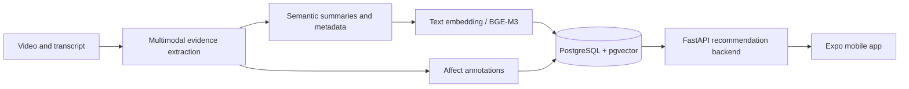

# Ataraxia

**A research-oriented short-video recommendation system with explicit semantic and affective signals.**

Ataraxia brings together a mobile application, an API and recommendation backend, and a reproducible video-annotation pipeline. Rather than treating a video as only a title or category, the research pipeline processes audiovisual evidence, extracts semantic descriptors, records affect annotations, and constructs vector representations for retrieval and ranking.

> **Project status:** Active final-year project and research prototype. Individual modules are implemented at different levels of readiness; this repository is not presented as a turnkey production deployment or a publicly reproducible end-to-end benchmark.

## What is in this repository?

| Component | Purpose | Entry point |
| --- | --- | --- |
| `mobile/` | Expo / React Native application | [`mobile/README.md`](mobile/README.md) |
| `backend/` | FastAPI application, feed and onboarding services, catalogue sync, database migrations, and integration tests | [`backend/main.py`](backend/main.py) |
| `annotation/` | Annotation workers, dataset validation, semantic processing, calibration, and research evaluation | [`annotation/README.md`](annotation/README.md) |
| `backend/docs/` | Implementation notes, migration plans, audits, and operational records | [`backend/docs/`](backend/docs/) |

## System overview



The diagram illustrates the logical data flow, **not** a claim that all components run unattended in a production environment.

### Research and engineering focus

- **Multi-signal video understanding:** descriptive semantic information and separate affect annotations.
- **Vector retrieval:** dense text embeddings stored for semantic matching; affect features remain available as independent signals.
- **Recommendation engineering:** catalogue-backed retrieval, onboarding preferences, backend APIs, and integration workflows.
- **Reproducible processing:** recorded configs, validation scripts, processing jobs, and audit documentation.
- **Data stewardship:** controlled catalogue scope and explicit migration/synchronization procedures.

## Explore the implementation

**Start with the components rather than the raw data directories.**

1. Read [`annotation/README.md`](annotation/README.md) for annotation modules, research evaluation, and worker setup.
2. Inspect [`backend/video_data/`](backend/video_data/) for catalogue loading/synchronization logic and [`backend/onboarding/`](backend/onboarding/) for preference onboarding.
3. Inspect [`backend/tests/`](backend/tests/) for available integration and unit checks.
4. Open [`mobile/`](mobile/) for the app implementation and Expo configuration.

## Local development

### Backend

Python dependencies are listed in [`backend/requirements.txt`](backend/requirements.txt). Run from the repository root after configuring the required external services:

```bash
python -m venv .venv
# Activate the environment for your platform before continuing.
python -m pip install -r backend/requirements.txt
uvicorn backend.main:app --reload
```

**Important:** importing the backend requires Supabase and AWS/S3 environment variables. The checked-in [`backend/.env.example`](backend/.env.example) is not a complete application configuration template; inspect the backend source and integration documentation for required settings. Do not commit actual credentials.

### Mobile

```bash
cd mobile
npm install
npm run start
```

The app needs its expected backend/services configured. The mobile directory has its own dependencies and workflow.

### Annotation and research workflows

Read the setup, dependency boundaries, and explicit launch commands in [`annotation/README.md`](annotation/README.md). **Do not launch full annotation, data migration, or catalogue synchronization simply to check out the project.** These can be expensive or can write to external systems.

## Data, privacy and reproducibility

The repository contains substantial tracked metadata and experiment-related records. Not all video assets, credentials, checkpoints, and external database state are included. Counts in past audit documents represent historical snapshots, not guaranteed live state.

A prior repository audit found matching tracked data paths under both `data/` and `annotation/data/`. Before reorganizing these paths, validate consumers, references, experiment provenance, and Git history; **do not delete or rewrite them as part of a documentation-only change**.

For details, see the relevant [`backend/docs/`](backend/docs/) records and the [`annotation` documentation](annotation/README.md).

## Scope and claims

This repository documents an in-progress academic engineering project. Any model metrics, dataset counts, or performance claims should be traced to a specific run and evaluation protocol. This README intentionally does not advertise measured accuracy or deployment availability that has not been verified from the repository.

---

**Maintainer:** [Alihassan0155](https://github.com/Alihassan0155) · [Portfolio](https://ali-hassan-khan-portfolio.vercel.app/)
